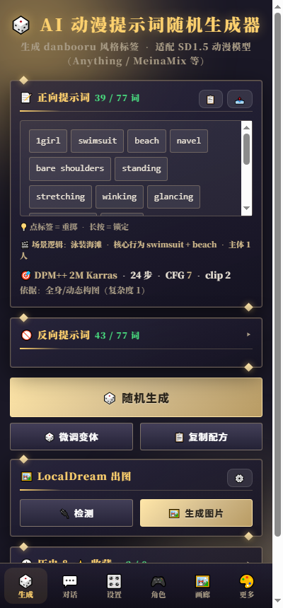
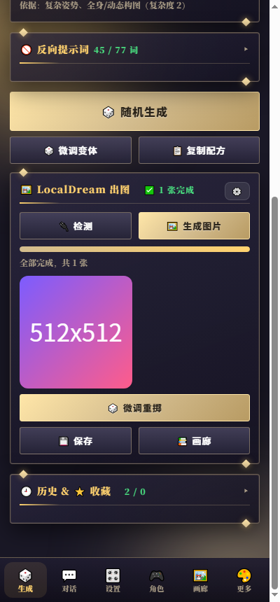
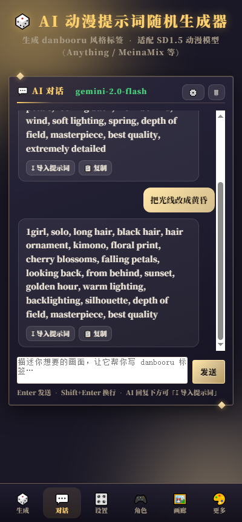
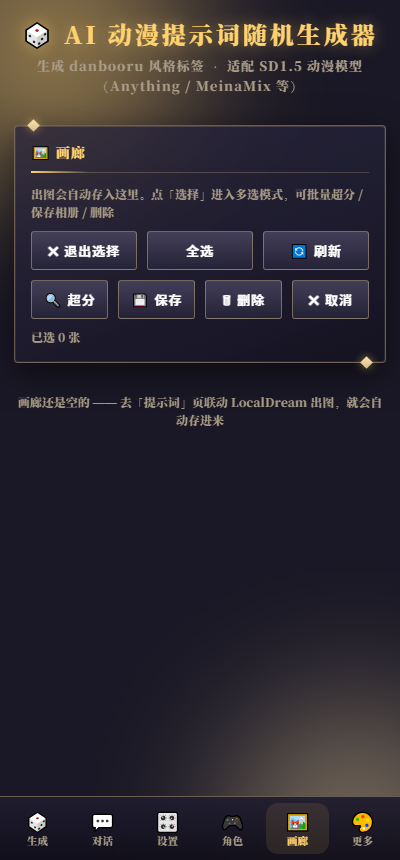
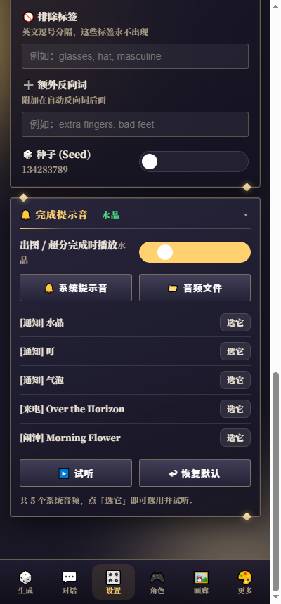
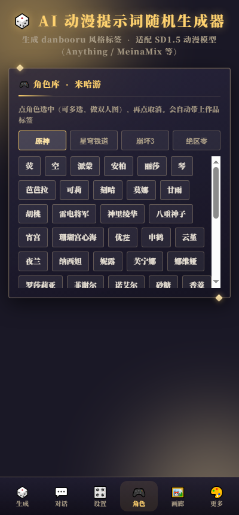
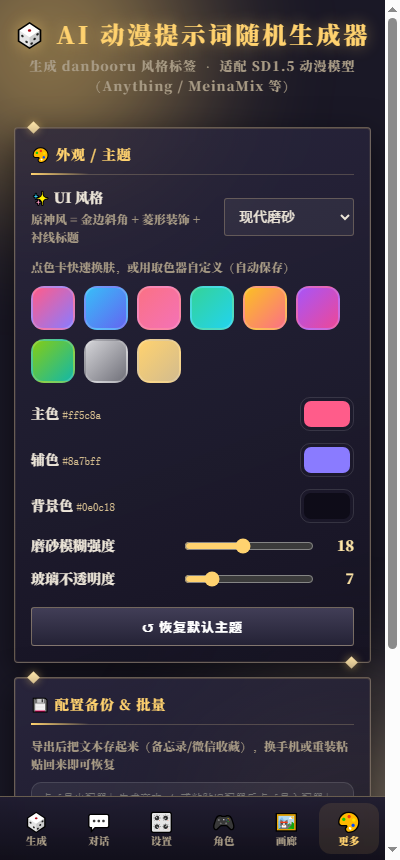

<div align="center">


# SD Prompt Studio

**A local prompt workbench for Stable Diffusion 1.5 on Android**

Generate coherent danbooru-style prompts in one tap, then render them on your phone's NPU via LocalDream.

[](../../releases)
[](../../actions)
[](https://developer.android.com)
[](../../releases)
[](LICENSE)
[](#-privacy)
[](#-privacy)

[English](README.md) · [简体中文](README.zh-CN.md)

  

</div>

---

## Table of Contents

- [What is this](#-what-is-this)
- [Features](#-features)
- [Screenshots](#-screenshots)
- [Install](#-install)
- [Quick Start](#-quick-start)
- [LocalDream Integration](#-localdream-integration)
- [Project Structure](#-project-structure)
- [Building from Source](#-building-from-source)
- [GitHub Actions](#-github-actions)
- [Technical Notes](#-technical-notes)
- [FAQ](#-faq)
- [Privacy](#-privacy)
- [Disclaimer](#-disclaimer)
- [License](#-license)
- [Contributing](#-contributing)

---

## 🎯 What is this

**SD Prompt Studio** is a **157 KB single-file Android app** that solves three problems:

1. **You don't know what to write** — 4,000+ built-in danbooru tags, one tap produces a full prompt
2. **Your prompts are incoherent** — 55 *scene templates* guarantee only one action, one location and one camera setup per prompt, so tags never contradict each other
3. **You keep switching apps** — it talks to LocalDream's HTTP API directly, and also does batching, upscaling and gallery management

It is **not** an online service. Everything runs locally on your phone. No sign-up, no ads, no telemetry.

---

## ✨ Features

### 🎲 Prompt Generation

| Feature | Description |
|---|---|
| **Smart parameter hints** | Suggests sampler / steps / CFG / clip skip based on prompt complexity |
| **Live token counter** | Hard-capped at CLIP's **77-token** limit, overflow is trimmed automatically |
| **Per-tag reroll** | Tap any tag to reroll just that one, everything else stays |
| **Tag locking** | Long-press a tag to lock it 🔒 — it survives every reroll |
| **Variation engine** | Keep the seed + swap 2–4 detail tags → **same style, different details** |
| **Bilingual output** | 580+ EN↔ZH mappings; export as English, Chinese, or both |
| **Natural-language mode** | Besides tag lists, produces a readable English/Chinese sentence |
| **Bilingual UI** | Switch the whole app interface between Chinese and English |
| **Config backup** | Export / import the whole configuration as text |

### 🎬 Scene Logic Engine

Naive random sampling pulls tags from every pool independently, which inevitably produces contradictory combinations that the model simply cannot render.

This project is **scene-driven** instead:

```
1. Pick one coherent scene (1 of 55)
2. The scene brings its own: core action + matching pose / expression /
   location / camera / lighting / subject count
3. Fill in details only from what that scene allows
4. Remaining slots get generic tags (hair, eyes, quality, art style)
```

**55 scene templates** grouped by content rating tier:

| Tier | Count |
|---|---|
| Tier 1 — platform-safe | 5 |
| Tier 2 — suggestive | 5 |
| Tier 3 — mature | 5 |
| Tier 4 — adult | 27 |
| Tier 5 — unrestricted | 13 |
| **Total** | **55** |

**12 mutual-exclusion groups** keep things consistent:

```
Pose group       31 entries → only one pose ever appears
Activity group   30 entries → only one primary activity
Hair / eyes / build / clothing-state / posture groups …
```

Verified over 660 generated prompts: **0** core-tag losses, **0** exclusion violations.

### 💬 AI Chat

Built-in streaming client for any OpenAI-compatible endpoint, with **10 official presets**:

| Provider | Free tier | Base URL |
|---|---|---|
| **Groq** | ✅ Free, very fast | `https://api.groq.com/openai/v1` |
| **Google Gemini** | ✅ Generous free tier | `https://generativelanguage.googleapis.com/v1beta/openai` |
| **OpenRouter** | ✅ Has `:free` models | `https://openrouter.ai/api/v1` |
| **Zhipu GLM** | ✅ `glm-4-flash` is free | `https://open.bigmodel.cn/api/paas/v4` |
| **SiliconFlow** | ✅ Credits on signup | `https://api.siliconflow.cn/v1` |
| **Alibaba Bailian** | ✅ Free quota | `https://dashscope.aliyuncs.com/compatible-mode/v1` |
| DeepSeek / Moonshot / OpenAI / Custom | 💰 | — |

**Killer feature — one-tap prompt import:**

```
You:  a girl in a kimono on a rainy night train, looking back
AI:   1girl, solo, kimono, train interior, rain, night, neon lights, looking back...
      ↓ tap "↧ Import as prompt"
      ↓ English tags extracted automatically (markdown fences and prose stripped)
Generate page: ready to use ✅
```

> ⚠️ No shared API keys are bundled. Use your own key — the UI links straight to each provider's key page.

### 🖼️ LocalDream Integration

Uses [LocalDream](https://github.com/xororz/local-dream)'s local HTTP API (`127.0.0.1:8081`) to render on your phone's NPU.

| Feature | Description |
|---|---|
| **One-tap render** | Prompt + sampler / steps / CFG / seed submitted directly |
| **Live progress** | SSE streaming: `image 2/4 · step 12/22 · 18s` |
| **Batching** | 1 / 2 / 4 / 6 / 8 images per run, seeds auto-incremented (+7919) |
| **4× upscaling** | Calls LocalDream's undocumented `/upscale` endpoint, 512 → 2048 |
| **Upscaler path autodetect** | Probes 10 candidate paths and fills in the working one |
| **Completion sound** | System ringtone or any audio file, played when a run finishes |

**Connection stability fixes** (all real bugs found in testing):
- All requests use `Proxy.NO_PROXY` — otherwise the first connection to `127.0.0.1` times out when a VPN is active
- The SSE connection is **fully closed before** notifying the frontend — otherwise the next request blocks on the backend's inference lock
- Connection-level errors retry automatically up to 3 times

### 🖼️ Gallery

| Feature | Description |
|---|---|
| **Auto-save** | Rendered images land in the app's private gallery |
| **Multi-select** | Batch export to system album / batch upscale / batch delete |
| **Recipe viewer** | Tap an image to see its full prompt and parameters |
| **One-tap restore** | "Vary & reroll" restores that image's prompt and seed, tweaks a few details |
| **Upscale badge** | 4×-upscaled images are marked `4×` |

### 🎨 Dual Themes

- **Modern glass** — rounded corners, frosted glass, gradient accents
- **Genshin-style** — gold bevels, diamond ornaments, serif headings, gold gradient buttons (with a matching app icon)

Both support custom accent / secondary / background colors, blur and opacity.

### 🎮 Misc

- **Character library** — 140 characters across four HoYoverse titles
- **12 scene presets** — apply a whole mood in one tap (sakura, cyberpunk, underwater…)
- **Exclude tags** — force certain tags to never appear
- **Extra negatives** — appended after the auto-generated negatives
- **Six-tab bottom navigation** — Generate / Chat / Settings / Characters / Gallery / More

---

## 📸 Screenshots

| Generate | Result | AI Chat |
|---|---|---|
|  |  |  |

| Gallery | Settings | Characters |
|---|---|---|
|  |  |  |

<div align="center">

</div>

---

## 📲 Install

### Download

Grab `PromptGenerator.apk` from [Releases](../../releases), or download the artifact from the latest [Actions](../../actions) run.

> The prebuilt APK is **debug-signed** — intended for personal sideloading only.

### Steps

1. Open the APK on your phone
2. If prompted about unknown sources, allow your file manager to install apps
3. On MIUI / HyperOS you may see a security scan — choose **Install anyway**

### Requirements

| Item | Requirement |
|---|---|
| Android | 5.0 (API 21)+ |
| Network | Only needed for AI Chat; prompt generation is fully offline |
| Rendering | Requires [LocalDream](https://github.com/xororz/local-dream) installed separately |

### ⚠️ Upgrading

Uninstalling wipes the gallery (images live in the app-private directory `/data/data/com.promptgen.app/files/gallery/`).

To keep them, multi-select in the gallery and tap **Save** — images are exported to `Pictures/PromptGen/`.

---

## 🚀 Quick Start

### Just want a prompt (no rendering)

```
1. Open the app → "Generate" tab
2. Tap "Randomize" → you get a full prompt
3. Tap "Copy recipe" → paste into any SD tool (WebUI / ComfyUI / mobile)
```

Don't like a tag? **Tap it** to reroll just that one.

Want it fixed? **Long-press it** → turns into 🔒 and survives every reroll.

### Producing a set of "same style, different details" images

The recommended workflow:

```
Render one image        ← get something you like
      ↓
Vary & reroll           ← keeps the seed, swaps 2–4 detail tags
      ↓
Vary & reroll ×N        ← repeat for a coherent set
```

**Why it works**: in SD, keeping the same seed while slightly editing the prompt preserves composition and lighting — only the details change.

The variation engine guarantees:
- ✅ Quality / art style / subject / character / **core action** / scene **never change**
- ✅ Only hair, eyes, expression, pose, camera, lighting and body details move
- ✅ Scene-bound tags are only swapped within **that scene's own candidate pool**

Measured over 300 variations: **0** core-tag losses, **84.3%** of tags preserved on average.

### Letting an LLM write prompts for you

```
1. "Chat" tab → ⚙️ (top right)
2. Pick "Groq (free, very fast)" → tap "Open provider site"
3. Sign up, copy your key → paste into "API Key" → tap "Test connection"
4. Type your idea → Send
5. Tap "↧ Import as prompt" under the reply
```

---

## 🔗 LocalDream Integration

This app calls LocalDream's local HTTP API. **LocalDream must be installed separately.**

### Endpoints used

| Endpoint | Purpose |
|---|---|
| `POST /generate` | SSE streaming render |
| `POST /tokenize` | Connectivity check |
| `POST /upscale` | 4× upscaling (undocumented) |

### Prerequisites for rendering

1. **Load a model in LocalDream first** — its API only starts once a model is loaded
2. **The resolution must match what LocalDream has selected** (usually 512×512)
3. Upscaling additionally needs the upscaler model path

### How to find the upscaler path

LocalDream's path rule is **fixed** (extracted from its source):

```
<models_dir>/models/<upscaler_id>/upscaler.bin
```

There are only two upscaler IDs:

| ID | Model |
|---|---|
| `upscaler_anime` | Real-ESRGAN x4plus anime 6B |
| `upscaler_realistic` | 4x-UltraSharpV2 Lite |

With the default models directory, the full path is:

```
/data/data/io.github.xororz.localdream/files/models/upscaler_anime/upscaler.bin
```

**You don't have to type it** — tap **Auto-detect path** and the app probes 10 candidate paths, filling in whichever one works.

### ⚠️ Upscaling requires switching LocalDream to its upscaler page

LocalDream's **generation backend and upscaler backend are mutually exclusive processes**, both bound to port 8081.

```
1. This app renders an image   (generation backend running)
2. Switch to LocalDream → open its Upscaler page (backend switches)
3. Switch back to this app → upscale
```

---

## 📁 Project Structure

```
sd-prompt-studio/
├── README.md
├── README.zh-CN.md
├── LICENSE
├── CONTRIBUTING.md
├── .gitignore
│
├── .github/
│   ├── workflows/build.yml             # CI: build + release APK
│   └── ISSUE_TEMPLATE/
│       ├── bug_report.yml
│       ├── feature_request.yml
│       └── config.yml
│
├── src/
│   └── index.html                      # all frontend logic (single file, 184 KB)
│
├── android/
│   ├── AndroidManifest.xml
│   ├── build.sh                        # POSIX build script (CI, Linux/macOS)
│   ├── build.ps1                       # PowerShell build script (Windows)
│   ├── gen_icon.py                     # procedural icon generator (Pillow + NumPy)
│   ├── res/mipmap-*/ic_launcher.png    # 5 density buckets
│   └── src/com/promptgen/app/
│       └── MainActivity.java           # WebView host + all native capability (52 KB)
│
├── docs/
│   └── screenshots/
│
└── releases/
    └── PromptGenerator-v3.7.apk
```

### Frontend (`src/index.html`)

A single-file app — no framework, no build step, no npm dependencies. Open it and it runs.

| Module | Responsibility |
|---|---|
| `P` | 30+ tag pools, 4,000+ tags |
| `CN` | 580+ EN↔ZH mappings |
| `SCENARIOS` | 55 scene templates |
| `EXCLUSIVE` | 12 mutual-exclusion groups |
| `generateTags()` | Scene-driven tag generation |
| `makeVariation()` | Variation engine |
| `computeRecommendation()` | Sampler / steps / CFG hints |
| `outString()` / `toSentence()` | Bilingual + natural-language output |
| `AI_PROVIDERS` | 10 LLM provider presets |

### Native (`MainActivity.java`)

| Capability | Why it must be native |
|---|---|
| **HTTP / SSE** | The WebView loads from `file://`, so cross-origin requests are blocked by CORS |
| **LocalDream integration** | Same reason; streaming progress |
| **AI Chat** | Same reason; parses `data:` SSE frames |
| **Upscaling** | Binary RGB request body + JPEG response |
| **Gallery I/O** | Private storage, thumbnail generation, MediaStore export |
| **Completion sound** | `RingtoneManager` / `MediaPlayer` |
| **File picking** | `ACTION_OPEN_DOCUMENT` |

---

## 🔨 Building from Source

This project **does not use Gradle**. It builds through a hand-rolled pipeline; the only dependencies are the Android SDK, JDK 17 and (optionally) Python.

### Requirements

| Tool | Version |
|---|---|
| Android SDK Build-Tools | 34.0.0 |
| Android Platform | android-33 |
| JDK | 17 |
| Python | 3.8+ with Pillow & NumPy (icon generation only) |
| Bash *or* PowerShell | for the build script |

### Build (Linux / macOS)

```bash
export ANDROID_SDK_ROOT=/path/to/android-sdk
export ANDROID_HOME=$ANDROID_SDK_ROOT

mkdir -p android/assets
cp src/index.html android/assets/index.html

bash android/build.sh
# → PromptGenerator.apk
```

### Build (Windows)

```powershell
# 1. Edit the paths at the top of android/build.ps1
$SDK      = "C:\Users\you\AppData\Local\Android\Sdk"
$JDK      = "C:\path\to\jdk-17"
$KEYSTORE = "C:\Users\you\.android\debug.keystore"

# 2. Copy the frontend into assets
New-Item -ItemType Directory -Force android\assets | Out-Null
Copy-Item src\index.html android\assets\index.html

# 3. Regenerate icons (optional)
python android\gen_icon.py

# 4. Build
Set-ExecutionPolicy -Scope Process Bypass -Force
.\android\build.ps1
```

### What the pipeline does

```
1. aapt2 compile   compile resources
2. aapt2 link      link resources + manifest + assets
3. javac           compile Java (-encoding UTF-8 --release 8)
4. d8              dex every .class
5. aapt add        insert classes.dex into the APK
6. zipalign        4-byte alignment
7. apksigner       sign (v1 + v2 + v3)
```

### Pitfalls we hit (and fixed)

| Symptom | Cause | Fix |
|---|---|---|
| App crashes on launch | `d8` was only given the outer `.class`; inner classes went missing | Recursively enumerate **all** `.class` files |
| `unmappable character for encoding GBK` | `javac` defaulted to the system codepage | Added `-encoding UTF-8` |
| Build aborted for no reason | `javac`'s deprecation notes go to stderr and PowerShell treated them as fatal | `$PSNativeCommandUseErrorActionPreference = $false` |
| Blank screen after an edit | Iterated a tag pool that is an object, not an array | Added an `Array.isArray` guard |

---

## ⚙️ GitHub Actions

`.github/workflows/build.yml` builds a signed APK on every push and pull request, and attaches it to a GitHub Release when you push a `v*` tag.

```yaml
on:
  push:
    branches: [ main ]
    tags: [ 'v*' ]
  pull_request:
  workflow_dispatch:
```

**What it does:**

1. Checks out the repo
2. Sets up JDK 17 (Temurin) and the Android SDK
3. Installs `build-tools;34.0.0` and `platforms;android-33`
4. Generates a debug keystore with `keytool` if none is present
5. Copies `src/index.html` into `android/assets/`
6. Runs `android/build.sh`
7. Uploads the APK as a build artifact
8. On a `v*` tag, publishes it to a GitHub Release

### Signing with your own keystore (optional)

To produce a release-signed APK, add these repository secrets and the workflow will pick them up automatically:

| Secret | Contents |
|---|---|
| `KEYSTORE_BASE64` | `base64 -w0 your.keystore` |
| `KEYSTORE_PASSWORD` | keystore password |
| `KEY_ALIAS` | key alias |
| `KEY_PASSWORD` | key password |

Without them, CI falls back to a generated debug keystore.

### Triggering a release

```bash
git tag v3.7
git push origin v3.7
```

The APK shows up under **Releases** with the tag name.

---

## 🧠 Technical Notes

### Why a WebView instead of native UI

The 184 KB single-file frontend carries all the interaction logic (55 scene templates, 4,000+ tags, the variation engine, bilingual output…). Rewriting that natively would multiply both size and effort. **The shipped APK is 157 KB.**

### WebView pitfalls and workarounds

| Problem | Workaround |
|---|---|
| `file://` is cross-origin, `fetch` blocked by CORS | All network I/O lives in Java, results pushed back via `@JavascriptInterface` |
| `alert()` / `confirm()` are no-ops in WebView | Custom `appToast()` / `appConfirm()` plus `WebChromeClient.onJsAlert` |
| `@JavascriptInterface` methods don't run on the UI thread | Every callback goes through `runOnUiThread` |
| Strings containing quotes/newlines break the injected JS | Escaped with `JSONObject.quote()` |

### Performance work

| Problem | Cause | Fix |
|---|---|---|
| Rendering felt slower over time | Saving an image did disk write + decode + thumbnail + index on the main thread | Moved entirely to a background thread |
| Batching stuttered | The SSE connection wasn't closed before the next request, blocking on the backend's inference lock | `disconnect()` first, then notify the frontend |
| First connection always timed out | `HttpURLConnection` honours the system proxy by default | `openConnection(Proxy.NO_PROXY)` |

### Why the icon is generated procedurally

`android/gen_icon.py` draws it with Pillow + NumPy rather than shipping a bitmap:

- Radial glow blended via a NumPy distance field
- Diamonds drawn as four-vertex polygons (adjustable aspect)
- Two stroke layers plus 10 decreasing-alpha passes to fake a glow
- Text centred via `textbbox`, with 8-direction offsets for the outer glow

Changing colors or shape is just a parameter tweak, and the result stays crisp at any size.

---

## ❓ FAQ

<details>
<summary><b>The app crashes immediately on launch</b></summary>

Uninstall the old version, then install the new one. If it still crashes, capture `adb logcat | grep promptgen` and open an issue.
</details>

<details>
<summary><b>LocalDream connections always time out the first time</b></summary>

Fixed in v2.5 (system-proxy bypass + closing the previous SSE connection before sending the next request). Upgrade if you're on an older build.
</details>

<details>
<summary><b>Upscaling returns HTTP 500 "Failed to initialize upscaler model"</b></summary>

The path points at a file that can't be loaded — almost always a mistyped path.

Correct format: `<models_dir>/models/<upscaler_id>/upscaler.bin`

Use the **Auto-detect path** button instead of typing it manually.
</details>

<details>
<summary><b>My file manager can't see the gallery images</b></summary>

Expected. The gallery lives in the app-private directory `/data/data/com.promptgen.app/files/gallery/`, which Android 10+ sandboxing hides from every file manager.

Use **Save** to export images to `Pictures/PromptGen/` so they show up in your album.
</details>

<details>
<summary><b>AI Chat returns 401 / 429</b></summary>

- `401` → invalid or missing API key
- `403` → key lacks permission, or the model isn't available to you
- `404` → wrong base URL or model name
- `429` → rate limited (common on free tiers), retry later

The UI translates these into plain-language hints.
</details>

<details>
<summary><b>Why aren't free API keys bundled?</b></summary>

Because "free keys" circulating online are **someone else's paid quota being abused** — they break within hours and are not legitimate to use. Instead, the app ships 10 **official provider presets**, six of which have genuine free tiers. Sign up once, use your own key, stay stable long-term.
</details>

<details>
<summary><b>Rendering is slow</b></summary>

- First check the batch count isn't set to 8 (that's 8× the work)
- The progress line shows per-image elapsed time; on a Snapdragon 8s Gen 3, 22 steps should take roughly 15–40 s
- If a single image takes over a minute, review LocalDream's step settings
</details>

<details>
<summary><b>Does it support SDXL?</b></summary>

No. This project targets **SD1.5** (512×512, 77-token CLIP limit).

Also note: the Snapdragon 8s Gen 3 (SM8635) has a **cut-down HTP** (VTCM < 8 MB), so it can only run `_min`-tier QNN models and cannot run SDXL at all.
</details>

---

## 🔒 Privacy

| Item | Status |
|---|---|
| **Ads** | None — no ad SDK of any kind |
| **Tracking** | None — no analytics, no crash reporting |
| **Accounts** | Not required |
| **Offline** | Prompt generation works fully offline |
| **API keys** | Stored only in app-private `localStorage`; never uploaded anywhere |
| **Rendering** | Only talks to `127.0.0.1:8081` (your own LocalDream) |
| **AI Chat** | Only talks to the endpoint you configure |

**The only network activity** is AI Chat, and only after you configure an API yourself.

---

## ⚠️ Disclaimer

- This project is provided for **technical study and personal use**
- You are responsible for the prompts you generate and how you use them
- Comply with the laws and regulations of your jurisdiction
- Do not use it to generate anything unlawful
- This project is not affiliated with LocalDream, Stability AI, danbooru, or any LLM provider

The project ships a content-rating system so users can select the tier appropriate to their platform and jurisdiction. Users are expected to respect the terms of service of whatever platform they publish to.

---

## 📄 License

[MIT](LICENSE)

Third-party notices:

| Component | License |
|---|---|
| [LocalDream](https://github.com/xororz/local-dream) | CC BY-NC 4.0 (**non-commercial**) |

> This project talks to LocalDream over its HTTP API. It neither bundles nor modifies LocalDream's source. Note that LocalDream itself is **non-commercially licensed**.

---

## 🤝 Contributing

Contributions are welcome! Please read [CONTRIBUTING.md](CONTRIBUTING.md) first.

Quick summary:

- 🐛 **Bugs** → use the [bug report template](../../issues/new?template=bug_report.yml)
- 💡 **Features** → use the [feature request template](../../issues/new?template=feature_request.yml)
- 🔧 **Code** → fork, branch, and open a PR
- 🌍 **Translations** → the `CN` dictionary in `src/index.html` is easy to extend

---

<div align="center">

**If this project helps you, consider giving it a ⭐ Star!**

Made with ❤️ for the SD community

</div>
